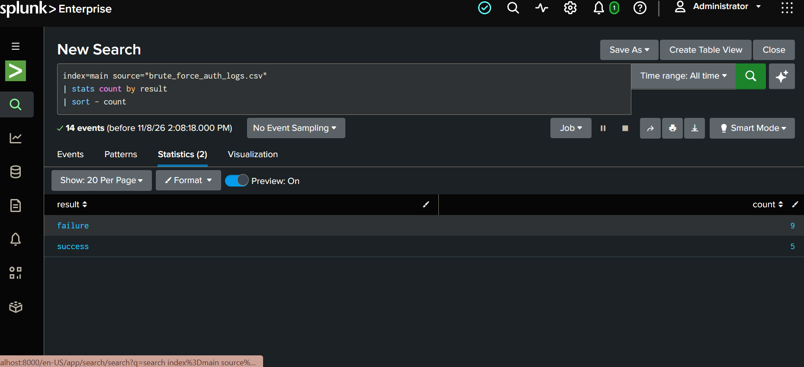
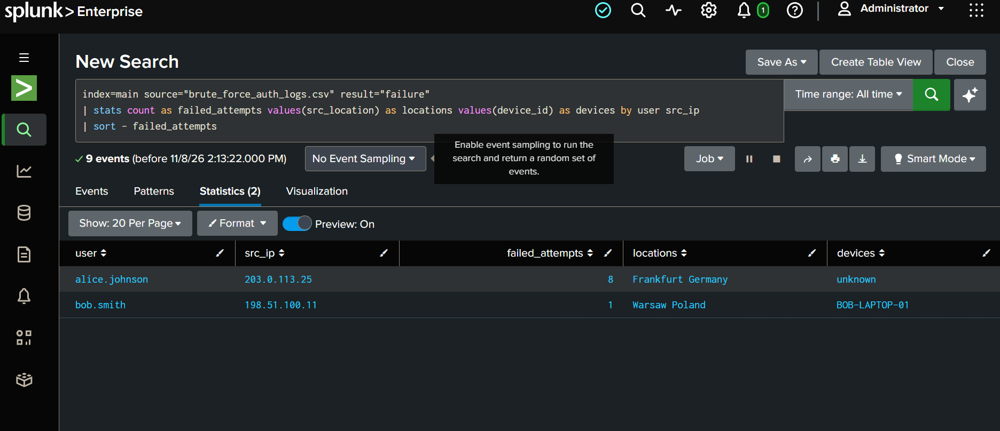
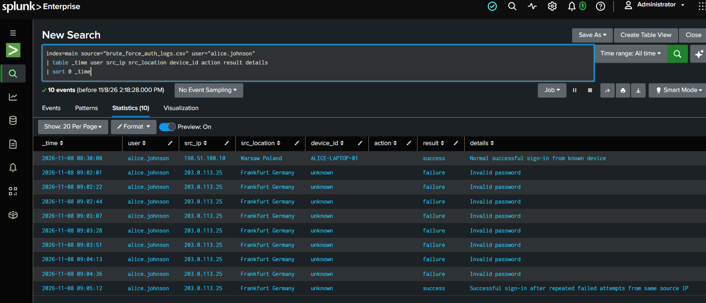
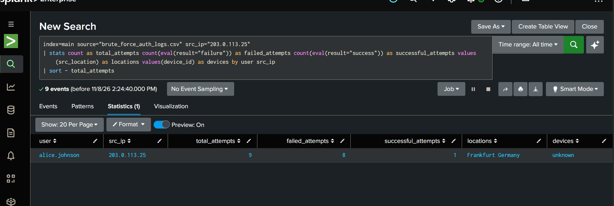
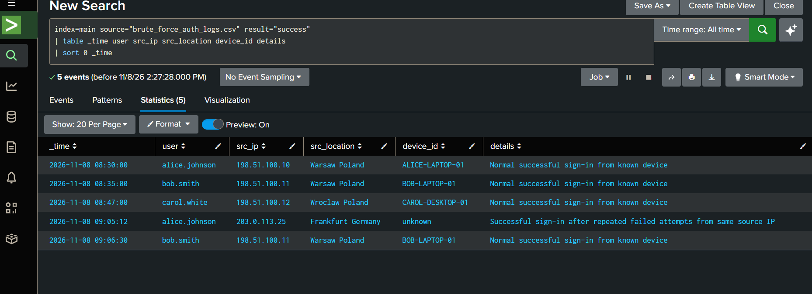

# Brute Force Login Investigation — SOC L1

**Project status:** In progress  
**Dataset:** [`data/brute_force_auth_logs.csv`](data/brute_force_auth_logs.csv)  
**Environment:** Splunk  
**Index:** `main`


## 1. Authentication Event Overview

**Objective:** Get an overview of authentication events and determine the distribution of successful and failed login attempts.

**Executed SPL:**

```spl
index=main source="brute_force_auth_logs.csv"
| stats count by result
| sort - count
```

**Evidence:**



**Results:**

The search returned 14 authentication events:

| Authentication result | Event count |
|---|---:|
| Failure | 9 |
| Success | 5 |
| **Total** | **14** |

**Analysis:**

Failed authentication attempts account for approximately 64.3% of all recorded events, while successful logins account for 35.7%.

The number of failed attempts indicates that authentication activity requires further investigation. However, this overview alone is insufficient to classify the activity as a brute-force attack.

The next step is to identify which accounts and source IP addresses are associated with the failed login attempts.


## 2. Failed Login Analysis

**Objective:** Identify accounts targeted by repeated failed authentication attempts and examine the associated source IP addresses, locations and devices.

**Executed SPL:**

```spl
index=main source="brute_force_auth_logs.csv" result="failure"
| stats count as failed_attempts values(src_location) as locations values(device_id) as devices by user src_ip
| sort - failed_attempts
```



**Results:**

The search returned 9 failed authentication events grouped into two user/IP combinations.

| User | Source IP | Failed attempts | Location | Device |
|---|---|---:|---|---|
| alice.johnson | `203.0.113.25` | 8 | Frankfurt, Germany | unknown |
| bob.smith | `198.51.100.11` | 1 | Warsaw, Poland | BOB-LAPTOP-01 |

**Analysis:**

Eight failed login attempts were associated with `alice.johnson`, all originating from the same source IP address and an unknown device, with Frankfurt, Germany recorded as the location.

In comparison, `bob.smith` had only one failed login attempt from a known device in Warsaw.

The repeated failures targeting Alice's account represent a suspicious authentication pattern consistent with a possible brute-force attempt.

**Preliminary assessment:** Alice's account requires further investigation. The next step is to examine her complete authentication history and determine whether any successful login occurred after the repeated failures.

**Note:** The dataset is synthetic. The IP addresses and geographic locations are simulated indicators and should not be treated as real-world threat intelligence.


## 3. Alice Johnson — Authentication Timeline

**Objective:** Review the complete authentication history of the targeted account and determine whether repeated failed login attempts were followed by a successful authentication.

**Executed SPL:**

```spl
index=main source="brute_force_auth_logs.csv" user="alice.johnson"
| table _time user src_ip src_location device_id action result details
| sort 0 _time
```



**Results:**

The search returned 10 authentication events associated with Alice Johnson.

The observed sequence was:

| Time | Source IP | Location | Device | Result |
|---|---|---|---|---|
| 08:30:00 | `198.51.100.10` | Warsaw, Poland | ALICE-LAPTOP-01 | Success |
| 09:02:01–09:04:36 | `203.0.113.25` | Frankfurt, Germany | unknown | 8 × Failure |
| 09:05:12 | `203.0.113.25` | Frankfurt, Germany | unknown | Success |

All eight failed attempts reported `Invalid password`.

The final successful authentication was recorded with the detail:

`Successful sign-in after repeated failed attempts from same source IP`

**Analysis:**

The timeline reveals a suspicious sequence of authentication events:

- Alice initially authenticated successfully from her known device in Warsaw.
- Eight consecutive failed login attempts followed from a different IP address in Frankfurt.
- All failed attempts originated from the same IP address and an unknown device.
- A successful authentication occurred from that same suspicious source IP just 36 seconds after the last failed attempt.

The change from Warsaw to Frankfurt within 32 minutes also represents a potential impossible-travel indicator.

**Assessment:** The observed pattern is consistent with a brute-force attempt followed by a potentially successful account compromise. The successful authentication after repeated failures significantly increases the severity of the incident.

**Note:** The dataset uses synthetic IP addresses and simulated geographic locations. The impossible-travel observation is therefore a scenario indicator, not real-world geolocation evidence.


## 4. Suspicious Source IP Investigation

**Objective:** Determine whether the suspicious source IP address targeted multiple accounts or focused exclusively on Alice Johnson's account.

**Executed SPL:**

```spl
index=main source="brute_force_auth_logs.csv" src_ip="203.0.113.25"
| stats count as total_attempts count(eval(result="failure")) as failed_attempts count(eval(result="success")) as successful_attempts values(src_location) as locations values(device_id) as devices by user src_ip
| sort - total_attempts
```



**Results:**

The search returned 9 authentication events associated with the suspicious IP address.

| User | Source IP | Total attempts | Failed attempts | Successful attempts |
|---|---|---:|---:|---:|
| alice.johnson | `203.0.113.25` | 9 | 8 | 1 |

Additional observed attributes:
- Location: Frankfurt, Germany.
- Device: `unknown`.

**Analysis:**

All nine authentication attempts from `203.0.113.25` were associated with Alice Johnson's account.

Eight attempts failed due to invalid passwords, followed by one successful authentication from the same IP address.

No other user accounts were associated with this source IP in the supplied dataset.

This suggests a targeted brute-force attempt against a single account rather than password spraying across multiple accounts.

**Assessment:** High-priority suspicious authentication activity. The successful sign-in following repeated failed attempts raises strong suspicion of account compromise.


## 5. Successful Authentication Review

**Objective:** Review all successful authentication events and identify unusual logins that may indicate successful account compromise.

**Executed SPL:**

```spl
index=main source="brute_force_auth_logs.csv" result="success"
| table _time user src_ip src_location device_id details
| sort 0 _time
```



**Results:**

The search returned 5 successful authentication events.

| User | Time | Source IP | Location | Device | Assessment |
|---|---|---|---|---|---|
| alice.johnson | 08:30:00 | `198.51.100.10` | Warsaw | ALICE-LAPTOP-01 | Normal |
| bob.smith | 08:35:00 | `198.51.100.11` | Warsaw | BOB-LAPTOP-01 | Normal |
| carol.white | 08:47:00 | `198.51.100.12` | Wroclaw | CAROL-DESKTOP-01 | Normal |
| alice.johnson | 09:05:12 | `203.0.113.25` | Frankfurt | unknown | Suspicious |
| bob.smith | 09:06:30 | `198.51.100.11` | Warsaw | BOB-LAPTOP-01 | Normal |

**Analysis:**

Four successful authentication events followed the expected pattern of known devices and previously observed locations.

However, Alice Johnson's successful authentication at 09:05:12 originated from the same suspicious IP address (`203.0.113.25`) associated with eight consecutive failed login attempts.

This successful authentication occurred 36 seconds after the final failed attempt.

The combination of repeated authentication failures, an unfamiliar source IP, an unknown device, an unusual geographic location and a subsequent successful login strongly suggests a possible account compromise.

**Assessment:** Suspicious successful authentication following a brute-force-like attack. The incident should be treated as a potential account compromise and escalated for further investigation.


## 6. Investigation Conclusion

The investigation identified suspicious authentication activity targeting Alice Johnson's account.

Eight consecutive failed login attempts originated from `203.0.113.25`, geolocated in Frankfurt, Germany, using an unknown device. These attempts occurred between 09:02:01 and 09:04:36.

At 09:05:12, a successful authentication was recorded from the same IP address and unknown device.

The investigation also identified a successful sign-in from Alice's usual device and location at 08:30, approximately 32 minutes before the suspicious activity.

The findings are consistent with a targeted brute-force attack against a single account, followed by a potentially successful account compromise.

The available logs do not establish the identity of the actor or any actions performed after authentication.

**Final assessment: High-priority suspected account compromise.**

## 7. Recommended Incident Response Actions

As a SOC L1 analyst, the recommended actions are:

1. **Escalate the incident** to SOC L2 / Incident Response due to the successful authentication following repeated failures.
2. **Verify the activity with Alice** using a trusted communication channel.
3. **Protect the account** by following the organization's account-compromise procedure, including password reset and session revocation where appropriate.
4. **Investigate MFA activity** and check whether any authentication methods were changed.
5. **Review further activity** associated with the suspicious IP and account, including available endpoint and application logs.
6. **Consider blocking the suspicious IP** in accordance with organizational security procedures.
7. **Monitor the account** for additional suspicious authentication attempts.

## 8. Investigation Limitations

The investigation is based on a synthetic dataset containing 14 authentication events.

The available logs do not include:
- Detailed MFA authentication history.
- Session and token information.
- Endpoint telemetry.
- Application access records after successful authentication.
- Evidence of data access or exfiltration.

Therefore, the investigation cannot establish what actions were performed after the suspicious successful login.

The IP addresses and geographic locations are simulated and must not be treated as real-world threat intelligence.

## 9. Final Project Summary

This project demonstrates a basic SOC L1 authentication investigation workflow using Splunk and SPL.

The investigation included:

- Reviewing authentication event distribution.
- Identifying repeated failed login attempts.
- Analyzing a targeted user's authentication timeline.
- Investigating a suspicious source IP.
- Comparing successful authentication events.
- Assessing potential account compromise.
- Documenting incident response recommendations.

The findings support a suspected brute-force attack against one employee account, followed by a successful suspicious authentication.

The investigation demonstrates the use of basic SPL searches, event aggregation, authentication analysis and evidence-based incident assessment.
